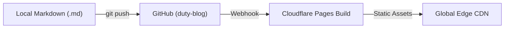

欢迎来到 **duty-blog**。这是一个推崇「少即是多」的个人极客博客。

## 为什么选择 Astro + Cloudflare Pages？

一个理想的个人技术博客应该具备三个特质：

1. **写作零阻力**：打开本地编辑器新建一个 `.md` 文件，`git push` 后自动上线。
2. **阅读零干扰**：等宽字体、高对比度终端配色、无弹窗、无第三方追踪脚本。
3. **维护零成本**：纯静态 HTML 托管在 Cloudflare 全球边缘节点，免费、免运维、永不宕机。

## 功能速览

### 1. 代码高亮与一键复制

基于 Shiki 的构建期双主题语法高亮（亮色与暗色自动切换），零客户端解析开销：

```typescript
interface EdgeNode {
  colo: string;
  latencyMs: number;
  cached: boolean;
}

export function formatNodeStatus(node: EdgeNode): string {
  const badge = node.cached ? 'HIT' : 'MISS';
  return `[${node.colo}] ${badge} in ${node.latencyMs.toFixed(1)}ms`;
}
```

### 2. LaTeX 数学公式支持

在 Markdown 中直接使用 `$...$` 或 `$$...$$`，构建期通过 `remark-math` 与 `rehype-katex` 预渲染为静态 HTML：

$$
L_{\text{effective}} = P_{\text{hit}} \cdot L_{\text{edge}} + (1 - P_{\text{hit}}) \cdot (L_{\text{edge}} + L_{\text{origin}})
$$

### 3. Mermaid 流程图支持

当文章内包含 `mermaid` 代码块时，自动按需渲染流程图：



## 下一步

你可以在 `src/content/blog/` 下继续添加新的 Markdown 文章，或在 `src/content/notes/` 下随手记录简短的想法。
